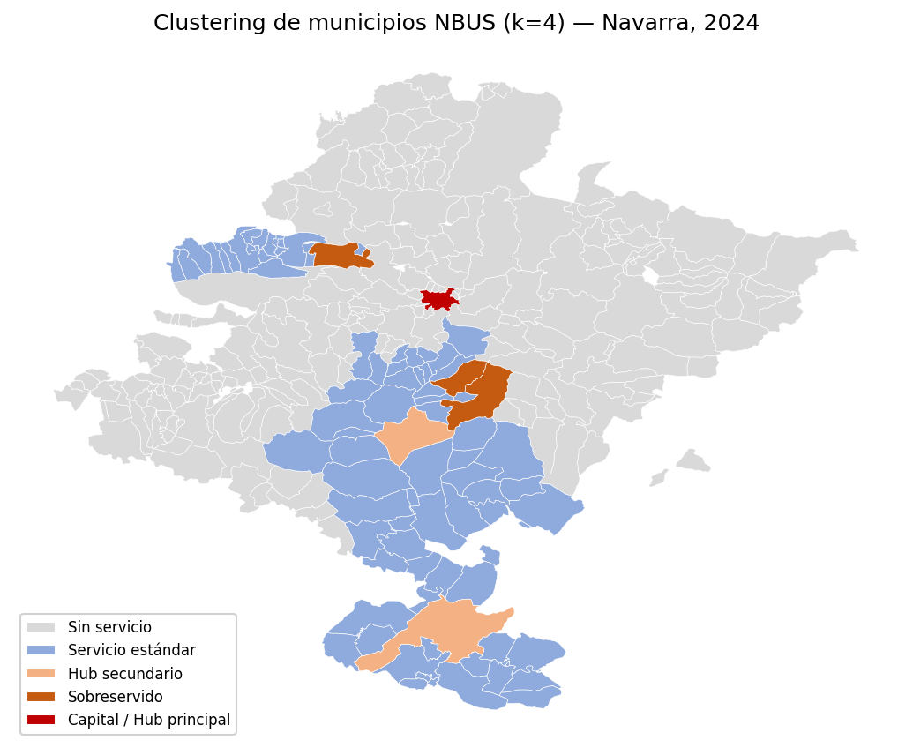

# 🚌 TFM NBUS — Análisis inteligente de la red de autobuses interurbanos de Navarra

> Trabajo de Fin de Máster — Máster en Big Data, Data Science y Business Analytics · Universidad Complutense de Madrid (UCM)
> Autor: **Marc Pérez Lleixà**

Análisis integral de la red de autobuses interurbanos de Navarra (**NBUS**) a
partir de sus datos oficiales **GTFS**, combinando ingeniería de datos,
*machine learning* y una capa de IA generativa. El proyecto parte de los
horarios y recorridos publicados por los operadores y los transforma en una
visión accionable sobre **cobertura territorial**, **frecuencias de servicio**
y **demanda de las rutas**, cerrando con un asistente conversacional que
permite consultar todos estos datos en lenguaje natural.

---

## 🎯 Objetivos

1. **Estructurar** los datos GTFS crudos en tablas analíticas listas para explotación.
2. **Segmentar** los municipios de Navarra según su nivel de cobertura de transporte (aprendizaje no supervisado).
3. **Modelar** la demanda / intensidad de servicio de cada ruta (aprendizaje supervisado).
4. **Democratizar el acceso** a los resultados mediante un asistente inteligente en lenguaje natural.
5. **Comunicar** los hallazgos con cuadros de mando interactivos.

---

## 🗂️ Datos

- **GTFS de NBUS** (`04_Proyecto_Fuente/gtfs_data/`): 32 rutas, 222 paradas, 492 viajes (*trips*), 3.584 registros de horarios y trazados de recorrido, operados por **Conda S.A.**, **Inter-Arriaga S.L.** y **La Burundesa S.A.U.**
- **Datos externos** (`datos_externos/`): población municipal de Navarra y geometría (GeoJSON) de los municipios, para cruzar servicio ofertado con territorio y habitantes.

---

## 🔬 Metodología

El pipeline completo vive en el notebook [`ETL_Nueva_v2.ipynb`](04_Proyecto_Fuente/etl/ETL_Nueva_v2.ipynb) y se organiza en cuatro fases:

### 1. ETL y enriquecimiento
Limpieza y correcciones sobre las tablas GTFS, cálculo de distancias (fórmula de *haversine*) y construcción de las tablas analíticas: detalle de viajes enriquecido, resumen por ruta, paradas enriquecidas, actividad temporal y cobertura por municipio.

### 2. Fase 1 — Clustering de cobertura *(ML no supervisado)*
Segmentación de los municipios con servicio mediante **K-Means**, con el número de clústeres (**k = 4**) elegido por el **método del codo** y validado con **silhouette score**. Resultado: perfiles de cobertura que distinguen desde municipios bien conectados de alta frecuencia hasta zonas con acceso mínimo.

### 3. Fase 2 — Predicción de demanda *(ML supervisado)*
Modelo **XGBoost** para estimar la intensidad de servicio por ruta, validado con **Leave-One-Out CV** y contrastado contra *baselines* (media global y regresión lineal) en igualdad de condiciones.
**R² ≈ 0.756**, claramente por encima de los modelos ingenuos.

### 4. Fase 3 — Asistente Inteligente *(IA generativa)*
Aplicación **Streamlit** que, apoyada en **LangChain + OpenAI**, responde preguntas en lenguaje natural sobre la red (cobertura, rutas, paradas, frecuencias) consultando directamente las tablas generadas en el ETL.



---

## 📁 Estructura del repositorio

```
TFM_NBUS/
├── 01_Memoria/            # Memoria del TFM (PDF)
├── 03_Graficos_y_Tablas/  # Figuras y tablas de resultados
└── 04_Proyecto_Fuente/    # Código y datos
    ├── etl/               # Notebook ETL + ML (ETL_Nueva_v2.ipynb)
    ├── app/               # Asistente Streamlit (app_nbus.py)
    ├── gtfs_data/         # Datos GTFS + datos externos
    ├── output/            # Tablas analíticas generadas (CSV)
    └── tableau/           # Cuadros de mando (.twb)
```

---

## 🛠️ Stack tecnológico

| Área | Herramientas |
|------|--------------|
| Lenguaje | Python |
| Datos / ML | pandas, numpy, scikit-learn, XGBoost, shapely |
| Visualización | matplotlib, Tableau |
| IA generativa | Streamlit, LangChain, OpenAI |
| Formato de datos | GTFS |

---

## ▶️ Cómo reproducirlo

**1. Ejecutar el ETL y el modelado**

Abre [`04_Proyecto_Fuente/etl/ETL_Nueva_v2.ipynb`](04_Proyecto_Fuente/etl/ETL_Nueva_v2.ipynb) en Jupyter y ejecútalo de arriba a abajo. Genera todas las tablas de `output/`.

**2. Lanzar el asistente inteligente**

```bash
cd 04_Proyecto_Fuente/app
pip install -r requirements.txt

# Crea un archivo .env con tu clave de OpenAI:
#   OPENAI_API_KEY=tu-clave-aqui

streamlit run app_nbus.py
```

> El asistente necesita una clave propia de OpenAI. El archivo `.env` **no** se incluye en el repositorio (está en `.gitignore`).

---

## 👤 Autor

**Marc Pérez Lleixà** — Trabajo de Fin de Máster, Máster en Big Data, Data Science y Business Analytics, Universidad Complutense de Madrid (UCM).

## 📄 Licencia

Código bajo licencia **MIT**. La memoria, el vídeo y los gráficos son obra académica del autor; los datos GTFS pertenecen a sus operadores. Ver [`LICENSE.md`](LICENSE.md) para el detalle.
